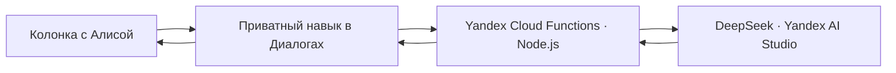

# Подключение DeepSeek к Алисе через Yandex Cloud

Инструкция и готовый обработчик для **собственного приватного навыка Алисы**.
Вы задаёте вопрос на колонке, DeepSeek составляет ответ, Алиса озвучивает его выбранным голосом.
Отдельный сервер, домен и постоянный API-ключ не нужны.

Это открытый исходный код: каждый создаёт свой навык и оплачивает вызовы модели в своём облаке.
Публикация этого репозитория не открывает доступ к уже работающему навыку автора.



## Как это работает

- Быстрый ответ приходит в той же реплике.
- Если ответ не успел подготовиться, навык говорит: **«Пу пу пу, тут надо подумать»**.
  Через несколько секунд скажите **«Готово?»** — обработчик проверит уже созданную задачу.
- Есть короткий контекст разговора, команды сброса и выхода.
- IAM-токен выдаётся сервисному аккаунту автоматически через контекст функции.
- Код без npm-зависимостей; тесты работают без ключей и платных запросов.

**Текущий защитный счётчик — 300 попыток генерации на пользователя в месяц по UTC.**
Денежный лимит, общий семейный бюджет и автоматическая остановка по расходу в рублях
в этой версии **не реализованы**. Подробнее — [Расходы и ограничения](#расходы-и-ограничения).

## Что понадобится

1. Аккаунт Яндекса, под которым настроена колонка.
2. [Yandex Cloud](https://console.yandex.cloud/) с активным платёжным аккаунтом и каталогом.
3. Доступ к модели `deepseek-v4.1-flash/latest` в [AI Studio](https://aistudio.yandex.ru/platform/).
   Доступность и названия моделей меняются: перед настройкой проверьте
   [список моделей](https://aistudio.yandex.ru/ru/docs/ai-studio/concepts/generation/models).
4. [Консоль Яндекс Диалогов](https://dialogs.yandex.ru/developer/).

Код рассчитан на Node.js 22 и новее. Для установки через веб-консоль Node.js на компьютере не нужен.

## 1. Создайте приватный навык

В Диалогах нажмите **Создать диалог → Навык в Алисе**. Заполните настройки:

| Поле | Что выбрать |
|---|---|
| Имя навыка | Своё уникальное имя, например **Соседа китайца** |
| Активационное имя | Например **Соседа китайца** |
| Тип доступа | **Приватный** |
| Backend | **Функция в Яндекс Облаке**; функцию подключим на шаге 4 |
| Хранилище данных | Включить **Использовать хранилище данных в навыке** |
| Нужно устройство с экраном | Не включать для обычного голосового диалога |
| Голос | На ваш выбор; он используется для озвучивания внутри навыка |

Пример запуска после публикации:

> Алиса, спроси у соседа китайца, почему небо голубое.

Это пример: имя должно быть доступно и соответствовать требованиям Яндекса.
Фактическое распознавание активационной фразы нужно проверить голосом после публикации.
Поле **Примеры запросов** задаёт примеры запуска для страницы навыка, а не список допустимых вопросов.

Заполните имя разработчика, описание, категорию, пример запроса и остальные обязательные поля.
Загрузите собственную иконку. Сохраните черновик и скопируйте идентификатор навыка из его URL —
это значение `ALICE_SKILL_ID`.

## 2. Настройте доступ к модели

В своём каталоге Yandex Cloud:

1. Создайте отдельный сервисный аккаунт, например `alice-deepseek`.
2. Назначьте ему роль **`ai.languageModels.user`** на этот каталог.
3. Скопируйте идентификатор каталога — `YANDEX_FOLDER_ID`.

Роли `admin` и `editor` для вызова модели не нужны. API-ключ в код вставлять не надо:
функция будет брать временный токен из `context.token.access_token`.
Сервисный аккаунт нужно именно **подключить к версии функции** на следующем шаге.

## 3. Загрузите функцию

Скачайте репозиторий кнопкой **Code → Download ZIP**, распакуйте его.
Для загрузки функции создайте **новый ZIP только из `index.js` и `package.json`**:
оба файла должны находиться в корне архива, без родительской папки.

Можно сделать это через архиватор или из папки проекта:

PowerShell:

```powershell
Compress-Archive -LiteralPath index.js,package.json -DestinationPath function.zip -Force
```

Linux/macOS:

```sh
zip function.zip index.js package.json
```

В консоли Yandex Cloud откройте **Cloud Functions**, создайте функцию и её версию:

| Настройка | Значение |
|---|---|
| Среда выполнения | Node.js 22 |
| Способ загрузки | ZIP-архив `function.zip` |
| Точка входа | `index.handler` |
| Память | 128 МБ |
| Таймаут | 4 секунды |
| Сервисный аккаунт | Аккаунт из шага 2 |
| Публичный вызов функции | Выключен |

В редакторе версии добавьте переменные окружения:

```dotenv
YANDEX_FOLDER_ID=YOUR_FOLDER_ID
ALICE_SKILL_ID=YOUR_SKILL_ID
ENABLED=false
```

Замените `YOUR_FOLDER_ID` и `YOUR_SKILL_ID` своими значениями.
`ENABLED=false` позволяет сначала проверить подключение без обращения к модели.
Файл `.env.example` — справочник: функция его автоматически не читает.

Необязательная переменная `ALICE_OWNER_ID` разрешает доступ только одному `user_id` из запроса Диалогов.
Оставьте её незаданной, если хотите делиться приватным навыком с семьёй через Диалоги.
Не публикуйте настоящие идентификаторы пользователей.

Сохраните версию и дождитесь статуса **Active**. Скопируйте идентификатор функции.

## 4. Подключите и проверьте

1. В настройках навыка выберите созданную функцию в поле **Функция в Яндекс Облаке**.
   Используйте прямое подключение функции, а не публичный Webhook URL.
2. Сохраните настройки. На вкладке **Тестирование** отправьте «Помощь», затем обычный вопрос.
   Пока `ENABLED=false`, вопрос должен вернуть сообщение, что доступ к модели не включён.
3. Проверьте настройки оплаты и [тариф модели](https://aistudio.yandex.ru/ru/docs/ai-studio/pricing).
4. Измените переменную функции на `ENABLED=true`, сохраните новую версию и дождитесь **Active**.
   Следующие обычные вопросы будут вызывать платный API модели.
5. Проверьте вопрос «Сколько будет два плюс два?», продолжение разговора,
   «Готово?» при ожидании, «Новый разговор» и «Хватит».

Для дополнительной диагностики через вкладку **Тестирование** самой Cloud Function
можно использовать JSON из [examples/request.json](examples/request.json), заменив `YOUR_SKILL_ID`.
Передайте его как прямой объект запроса навыка, без HTTP-обёртки `body`.
При ручном опросе результата переносите `session_state` предыдущего ответа в `state.session`,
а `user_state_update` — в `state.user`. Диалоги делают это автоматически.

## 5. Опубликуйте приватно

Отправьте навык на автомодерацию и после одобрения завершите публикацию, если консоль предложит это отдельно.
Убедитесь, что тип доступа остался **Приватный**.
Затем запустите его голосом на колонке под тем же аккаунтом Яндекса.

Интерфейс и сроки проверки могут меняться. Ориентируйтесь на текущий статус в Диалогах,
а не на обещание публикации за фиксированное время.

## Колонки семьи

Приватный навык доступен на поддерживаемых устройствах, где используется аккаунт автора.
Если другие колонки привязаны к другим Яндекс-аккаунтам, членства в семейной группе
самого по себе недостаточно для выдачи доступа к приватному навыку.

Откройте **Диалоги → ваш навык → Доступ**, сгенерируйте отдельную одноразовую ссылку
для каждого человека. Получатель должен открыть её под своим Яндекс-аккаунтом.
Ссылка действует сутки; после принятия доступ сохраняется.
Подробности: [Управление доступом](https://yandex.ru/dev/dialogs/alice/doc/ru/access).

При этом все обращения к модели оплачивает владелец облака.
История разговора хранится в рамках сессии, а счётчик попыток — отдельно для каждого пользователя.
Общая семейная память и семейные профили в этой версии отсутствуют.

## Команды

| Фраза | Действие |
|---|---|
| Обычный вопрос | Создать запрос к модели |
| Готово? | Получить ожидающий ответ |
| Отмена | Сбросить локальное ожидание |
| Новый разговор | Очистить контекст текущей сессии и ожидание |
| Помощь | Подсказка по использованию |
| Хватит / Стоп / Выход | Завершить навык |

Пока ответ готовится, любая обычная реплика проверяет предыдущую задачу.
Готовый ответ озвучивается без предположений о том, был ли задан новый вопрос.
Содержание этой проверочной реплики не отправляется как новый запрос к модели:
следующий вопрос задавайте после получения ответа или команды «Отмена».
Управляющие команды выхода, сброса и отмены обрабатываются отдельно.

## Расходы и ограничения

**300 попыток — это не 300 рублей.** В `index.js` проверка `quota.used >= 300`
ограничивает число запусков на пользователя за календарный месяц по UTC.
Счётчик увеличивается перед отправкой запроса, включая неудачные попытки.
Проверки готовности, помощь и команды сброса новые генерации не создают.

Счётчик хранится в `user_state` Диалогов. Он не обеспечивает строгий финансовый предел:
параллельные сессии, повторная доставка и сброс пользовательского хранилища могут повлиять на подсчёт.
После выдачи доступа семье каждый пользователь получает собственный счётчик.
Долларовый или рублёвый учёт по `usage` и атомарное резервирование средств не реализованы.

Ограничения входа и ответа уменьшают расход: вопрос до 600 символов, JSON сообщений
до 1800 UTF-8 байт, генерация до 384 выходных токенов, озвучивание до 950 символов.
Перед запросом сохраняются только помещающиеся последние сообщения.

Актуальные цены и дополнительные начисления проверяйте в
[AI Studio](https://aistudio.yandex.ru/ru/docs/ai-studio/pricing) и
[Cloud Functions](https://yandex.cloud/ru/docs/functions/pricing).
Бюджетные уведомления Яндекса полезны для контроля, но сами расходы не останавливают:
[документация бюджета](https://yandex.cloud/ru/docs/billing/concepts/budget).
Для оперативного выключения новых обращений к модели установите `ENABLED=false`
и сохраните новую версию функции. Уже принятые моделью задачи это не отменит.

## Почему иногда надо говорить «Готово?»

Диалоги ждут обработчик не более 4,5 секунды вместе с сетевой доставкой.
Код выделяет до трёх секунд на отправку и короткие опросы готовности, оставляя запас.
Холодный запуск и сеть всё равно могут привести к превышению срока.

Генерация идёт в фоне **на стороне AI Studio**, а не в памяти завершившейся функции.
Сохраняется ID задачи, поэтому следующий запуск функции может получить её результат.
После уже отправленного ответа обработчик не умеет сам возобновить речь на колонке:
нужна следующая реплика пользователя.

Повторный POST после ошибки автоматически не отправляется: таймаут не означает,
что модель не приняла запрос. Если ID не удалось получить, восстановление такого ответа
в этой версии невозможно. «Отмена» и «Новый разговор» очищают только локальное ожидание,
а не отменяют генерацию на стороне провайдера.

## Где менять поведение

Все настройки диалога находятся в [index.js](index.js):

| Что изменить | Где искать |
|---|---|
| Манера ответов | Константа `INSTRUCTIONS` |
| Фраза ожидания | Константа `WAIT` |
| Модель | Поле `model` в запросе к API |
| Длина генерации | `max_output_tokens: 384` |
| Лимит попыток | Проверка `quota.used >= 300` |
| Контекст | Ограничения массива `history` и размера `input` |

После изменения кода пересоберите ZIP и сохраните новую версию функции.
Смена модели требует проверки поддержки Responses API, фоновых задач и `reasoning.effort=none`.
Realtime-модель нельзя подключить простой заменой имени: этот обработчик работает с текстовыми запросами.

## Данные и безопасность

- Не открывайте публичный вызов функции. `ALICE_SKILL_ID` проверяет назначение запроса,
  но **не аутентифицирует публичный webhook**: это не секрет.
- Реплики, ответы и ID задачи передаются через `session_state` Диалогов.
  `user_state` содержит месяц и число попыток.
- Используется `store=true`: AI Studio сохраняет задачу для получения результата.
  Это не режим без хранения данных.
- Заголовок `x-data-logging-enabled: false` отключает диагностическое логирование запросов AI Studio;
  он не отменяет сохранение задачи через `store=true`.
- Код не записывает реплики и токены доступа в логи. Не добавляйте полное логирование `event` или `context`.
- Не публикуйте `.env`, ключи, запросы реальных пользователей, скриншоты личной консоли и её журналы.

## Тесты и статус

```sh
node --test
```

13 тестов подменяют API и проверяют быстрые и фоновые ответы, восстановление после нового
запуска функции, отсутствие повторного POST при опросе, ограничения доступа,
счётчик, таймауты, отмену и выход из зависшего ожидания. Сеть и ключи не нужны.

Исходный обработчик проверялся реальными запросами в Cloud Functions с Node.js 22
и DeepSeek V4.1 Flash. Работа на всех моделях колонок и семейный доступ отдельно не проверялись.
Наличие тестов не гарантирует задержку ответа конкретного облака или устройства.
Инструкция подготовлена 17 ноября 2026 года; интерфейсы и модели могут измениться.

## Другие реализации

- [ituzovlab-alice](https://github.com/ituzov/ituzovlab-alice) — Node.js и Timeweb, несколько провайдеров.
- [alice-llm-bridge](https://github.com/eluceon/alice-llm-bridge) — Rust, PostgreSQL, семейные профили и учёт стоимости.
- [alice-deepseek](https://github.com/zabarov/alice-deepseek) — PHP и прямой API DeepSeek.

## Документация платформ

- [Настройки навыка, голос и срок ответа](https://yandex.ru/dev/dialogs/alice/doc/ru/publish-settings)
- [Подключение Cloud Function к навыку](https://yandex.cloud/ru/docs/tutorials/serverless/alice-skill/console)
- [IAM-токен в контексте Node.js](https://yandex.cloud/ru/docs/functions/lang/nodejs/context)
- [Фоновые запросы AI Studio](https://aistudio.yandex.ru/ru/docs/ai-studio/operations/generation/background-request)

## Лицензия

[MIT](LICENSE). Неофициальный проект; не является продуктом Яндекса или DeepSeek.
